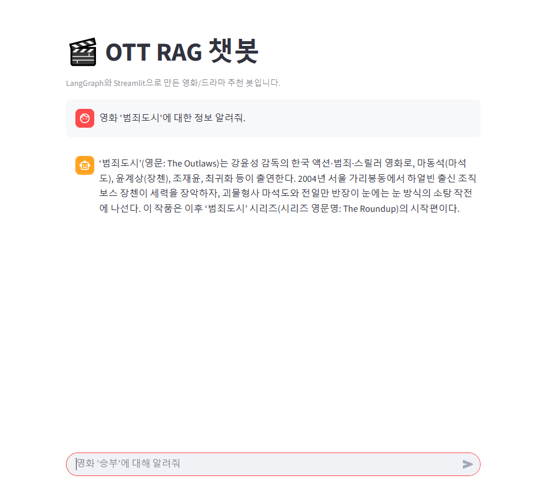
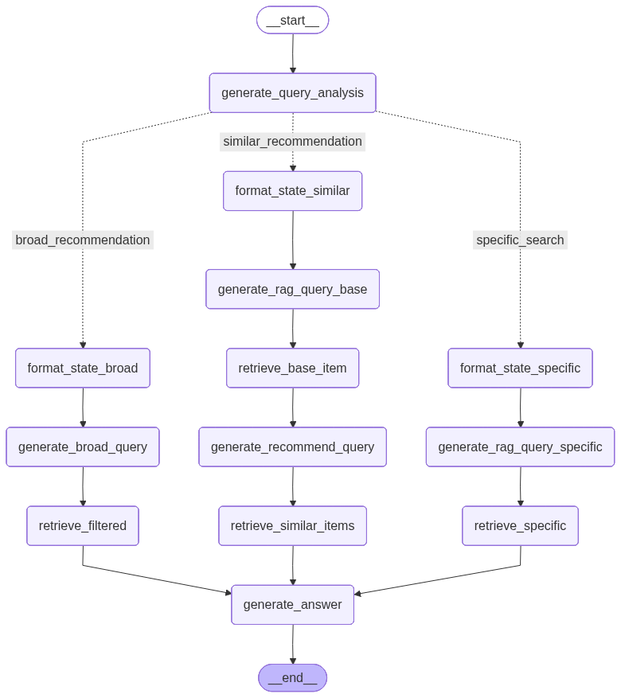

# OTT Recommendation Agent

An LLM-powered search and recommendation agent for Korean films and TV series, built with LangGraph, Pinecone and retrieval-augmented generation (RAG).

## Overview

The agent helps users discover films and TV series through natural language queries. It retrieves information from a custom dataset rather than relying solely on the LLM's existing knowledge.

- Analyses user intent and extracts search criteria using Pydantic structured outputs.
- Routes requests to three distinct search and recommendation workflows using LangGraph.
- Combines semantic retrieval with metadata filtering by genre, streaming provider, cast, director and release year for broad recommendations.
- Provides an interactive Streamlit chat interface.

## Demo



The application was designed for Korean-language queries. The screenshot was captured during the original development period.

| Workflow | Example query (English translation) |
| --- | --- |
| Specific Search | Tell me about the film *The Outlaws*. |
| Similar Recommendation | Recommend films similar to *The Match*. |
| Broad Recommendation | Recommend dramas on Netflix featuring Lee Byung-hun. |

## Architecture

### Data Pipeline

1. Collect Korean film and TV metadata from Wikidata using SPARQL.
2. Enrich records through the TMDB API with plot summaries, genres, cast and streaming availability.
3. Transform records into structured RAG documents and searchable metadata.
4. Generate embeddings using OpenAI and index the documents in Pinecone.

### Agent Workflow



- **Specific Search:** Generates an optimised query and retrieves relevant title information.
- **Similar Recommendation:** Retrieves a reference title, generates a new query based on its characteristics and performs a second retrieval.
- **Broad Recommendation:** Combines semantic search with metadata filters extracted from the user's request.

All three workflows use a shared answer generation node to produce responses grounded in retrieved documents.

## Tech Stack

| Component | Technology |
| --- | --- |
| Language | Python |
| Agent orchestration | LangGraph, LangChain, Pydantic |
| LLM and embeddings | GPT-4o-mini, text-embedding-3-large |
| Vector database | Pinecone |
| User interface | Streamlit |
| Containerisation | Docker |

## Getting Started

The original application uses Python 3.11 and requires OpenAI and Pinecone API credentials.

```bash
git clone https://github.com/elios404/ott-recommendation-agent.git
cd ott-recommendation-agent
python -m venv .venv
source .venv/bin/activate
pip install -r requirements.txt
```

Create a local `.env` file in the project root:

```env
OPENAI_API_KEY=your_openai_api_key
PINECONE_API_KEY=your_pinecone_api_key
```

A populated Pinecone index named `movie-rag-index` is required (3,072 dimensions, cosine similarity). To rebuild it from the prepared dataset:

```bash
pip install tqdm
cd src
python store_vectors_pinecone.py
cd ..
```

Start the application:

```bash
streamlit run src/app.py
```

The `arc/` directory contains earlier experimental notebooks, including ChromaDB implementations. A Dockerfile is also provided.

## Data Sources

- [Wikidata](https://www.wikidata.org/) — initial title metadata and identifiers.
- [TMDB](https://www.themoviedb.org/) — film and TV metadata and streaming availability.
- [Wikipedia](https://ko.wikipedia.org/) — supplementary data used in earlier experiments.

This product uses the TMDB API but is not endorsed or certified by TMDB.

## Project Status

Personal project developed in November–December 2025. The dataset targets Korean films and TV series released between 2015 and 2025. Streaming availability reflects the original collection period, not live provider information.

The application was demonstrated during development. The current runtime environment and external API integrations have not been revalidated.
